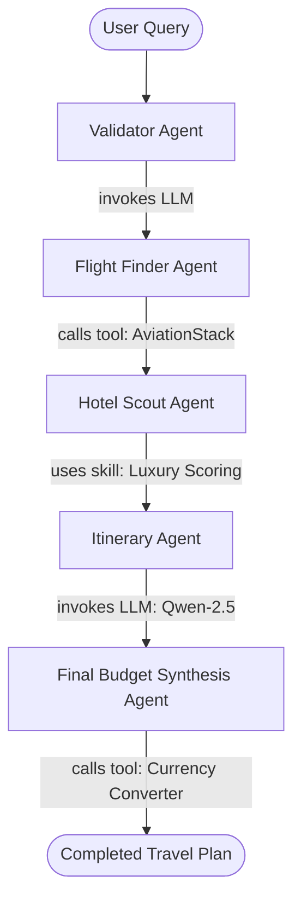

# AgentDAC — Universal Observability Plugin for AI Agents

[]()
[]()
[]()
[](LICENSE)
[]()

**AgentDAC (Agent Observability Graph)** is a self-contained, zero-configuration universal observability plugin and interactive execution DAG visualizer for multi-agent systems and LLM workflows.

Installable into arbitrary Python projects with a single command, AgentDAC **automatically manages its own local backend lifecycle** — no manual Uvicorn servers, database setups, or port configurations required.

---

## ⚡ 5-Line Universal Quick Start

```python
from agentdac import AgentDAC

# Backend auto-starts and connects seamlessly on port 8000
aog = AgentDAC(agent_id="research-bot")

with aog.session(metadata={"task": "market_analysis"}):
    with aog.llm(model="claude-3-7-sonnet", provider="anthropic") as span:
        span.set_tokens(tokens_in=350, tokens_out=90)
        span.set_cost(0.0024)
    
    with aog.tool("web_search") as span:
        span.set_input({"query": "AI agent telemetry standards"})
        span.set_output({"results": ["AgentDAC universal plugin standard"]})
```

Run the runnable quickstart example:
```bash
uv run python examples/quickstart_basic.py
```

---

## 💡 How It Works

```text
                  USER'S AGENT APPLICATION
                           │
                           │
                     AgentDAC SDK
                           │
                           ▼
                  Runtime Manager
                           │
             ┌─────────────┴─────────────┐
             │                           │
       Backend exists?              Backend missing?
             │                           │
             ▼                           ▼
          reuse                    start automatically (lock-safe)
             │                           │
             └─────────────┬─────────────┘
                           │
                           ▼
                 AgentDAC Local Backend
                 (Isolated Package Namespace)
                           │
                           ▼
                      Event Store
                    (SQLite / Postgres)
                           │
              ┌────────────┼────────────┐
              ▼            ▼            ▼
            Trace        DAG        Analytics
              │            │            │
              └────────────┼────────────┘
                           ▼
                     AgentDAC Dashboard
```

> **The developer integrates AgentDAC; AgentDAC manages itself.**

---

## 🏆 Featured Proof of Concept (POC): TripMate AI

AgentDAC has been tested and benchmarked against **TripMate AI** — a production-grade 5-agent LangGraph workflow executing multi-stage travel planning:



### Key POC Metrics
- **Pipeline Structure**: 5 specialized agents (`validator_agent`, `flight_agent`, `hotel_agent`, `itinerary_agent`, `final_agent`).
- **Telemetry Captured**: 22 hierarchical spans, 3,350 total tokens, $0.0037 cost, tool arguments, and skill confidence scores.
- **Latency Overhead**: **< 1.5%** total runtime impact via asynchronous micro-batching.
- **Parse-Tree DAG**: Every execution step reconstructed into an interactive DAG with labeled semantic transitions (`invokes LLM`, `calls tool`, `uses skill`, `sub-agent`).

👉 **Read the full case study**: **[docs/poc-tripmate-case-study.md](docs/poc-tripmate-case-study.md)**

Run the complete TripMate AI simulation in this repository:
```bash
uv run python examples/tripmate_poc_demo.py
```

---

## 📚 Complete Documentation Index

| Guide | Description |
| :--- | :--- |
| 📖 **[Architecture Deep Dive](docs/architecture.md)** | End-to-end system topology, Runtime Manager, DAG engine, persistence, and fail-open design |
| 🧪 **[TripMate AI Case Study (POC)](docs/poc-tripmate-case-study.md)** | Real-world LangGraph 5-agent case study with full execution profiles |
| 📊 **[Benchmark Report](benchmark.md)** | Installation speeds, startup latency, API throughput, and instrumentation overhead |
| 🐍 **[Python SDK Reference](docs/sdk.md)** | Comprehensive API documentation, context managers, decorators, and options |
| 🔌 **[Integrations Guide](docs/integrations.md)** | Setup guides for LangChain, LangGraph, Claude Code CLI hooks, and custom agents |
| 📋 **[Universal Event Schema](docs/event-schema.md)** | Specification of `AgentEvent`, field definitions, error structures, and IDs |
| 🛡️ **[Privacy & Redaction](docs/privacy.md)** | Built-in recursive secret masking, pattern matchers, and compliance controls |
| 🗺️ **[Implementation Roadmap](docs/roadmap.md)** | Verified completed phases (1–9) and upcoming OpenTelemetry & Knowledge Graph milestones |

---

## 📦 Installation Options

### 1. PyPI / uv (Recommended)
```bash
pip install agentdac
# or with uv:
uv add agentdac
```

### 2. One-Liner Script (Linux / macOS / WSL)
```bash
curl -fsSL https://raw.githubusercontent.com/sklearner26/AGENTDAC/main/install.sh | bash
```

### 3. PowerShell (Windows)
```powershell
irm https://raw.githubusercontent.com/sklearner26/AGENTDAC/main/install.ps1 | iex
```

### 4. Cross-Platform Python Installer
```bash
python install.py --venv
```

---

## 🚀 Advanced Capabilities

### 1. LangGraph & LangChain Zero-Boilerplate Callback Handler
Zero-friction tracing for LangChain chains and LangGraph state machines:

```python
from langchain_openai import ChatOpenAI
from agentdac import AgentDAC
from aog.integrations.langchain import AgentDACCallbackHandler

aog = AgentDAC(agent_id="support-agent")
handler = AgentDACCallbackHandler(aog, session_id="session-123")
llm = ChatOpenAI(callbacks=[handler])

# Works seamlessly with LangGraph StateGraph invocations:
graph = workflow.compile()
result = graph.invoke({"input": "Book flight to SFO"}, config={"callbacks": [handler]})
```

### 2. Specialized Skill Tracking
Track domain skills and reasoning procedures alongside tools and LLM steps:

```python
from agentdac import AgentDAC

aog = AgentDAC()

with aog.session(metadata={"workflow": "research"}):
    with aog.skill("luxury_budget_scoring", attributes={"algorithm": "weighted_amenities"}) as skill_span:
        skill_span.set_input({"budget": 250, "district": "Downtown"})
        skill_span.set_output({"selected_tier": "4-star", "confidence": 0.94})
```

### 3. Claude Code CLI Hook Integration
Forward observable hook payloads from Anthropic's Claude Code CLI directly into AgentDAC:

```bash
agentdac-claude-hook < hook-event.json
```
Automatically captures session IDs, tool executions, durations, costs, and parent-child correlation without touching private chain-of-thought tokens.

### 4. Zero-Hallucination AI Timeline Chatbot
The interactive dashboard includes an AI Chat assistant with direct context injection from the full session timeline:
- Queries are grounded strictly in the session spans JSON.
- Configurable via environment variables:
  ```bash
  export AGENTDAC_CHAT_API_KEY="your-api-key"
  export AGENTDAC_CHAT_MODEL="gpt-4o-mini" # or any OpenAI-compatible model
  export AGENTDAC_CHAT_BASE_URL="https://api.openai.com/v1" # optional
  ```

---

## 🛡️ Key Guarantees

1. **Package Isolation**: Packaged strictly under `agentdac` / `aog.backend`. Never collides with host applications using generic `server`, `app`, or `main` module names.
2. **Fail-Open Reliability**: Observability never crashes your agent (`fail_open=True` by default). Events buffer and drop gracefully if the backend is temporarily unreachable.
3. **Duplicate Prevention**: Inter-process file locking ensures multiple SDK instances, threads, or agent sessions share a single healthy backend.
4. **Context Propagation**: `contextvars`-based span trees automatically link nested LLM calls, tool executions, skills, and sessions.
5. **Built-in Redaction**: Recursive automatic redaction for API keys, bearer tokens, passwords, and authorization headers.

---

## 🖥️ React Dashboard

Start the visual inspection UI:
```bash
cd dashboard
npm install
npm run dev
```
Open **[http://localhost:5173](http://localhost:5173)** to inspect:
- Execution DAG with labeled transition edges
- Interactive timeline waterfall
- Span payloads, tokens, and cost inspector
- Zero-hallucination AI Chat assistant
- System-wide analytics overview

---

## 🐳 Docker Deployment

Run the complete AgentDAC stack (API backend + PostgreSQL + React Dashboard) with Docker Compose:

```bash
docker compose up -d
```
- Dashboard UI: `http://localhost:5173`
- Backend API & OpenAPI Docs: `http://localhost:8000/docs`

---

## 🧪 Testing & Code Quality

AgentDAC maintains a strict 100% green testing and quality standard:

```bash
# Run test suite (117 tests)
uv run pytest

# Check code formatting & linting
uv run ruff check .

# Static type verification (97 files)
uv run mypy .
```

---

## 📄 License

MIT License — see [LICENSE](LICENSE) file.
Copyright (c) 2026 Shreyansh Kesarwani.
