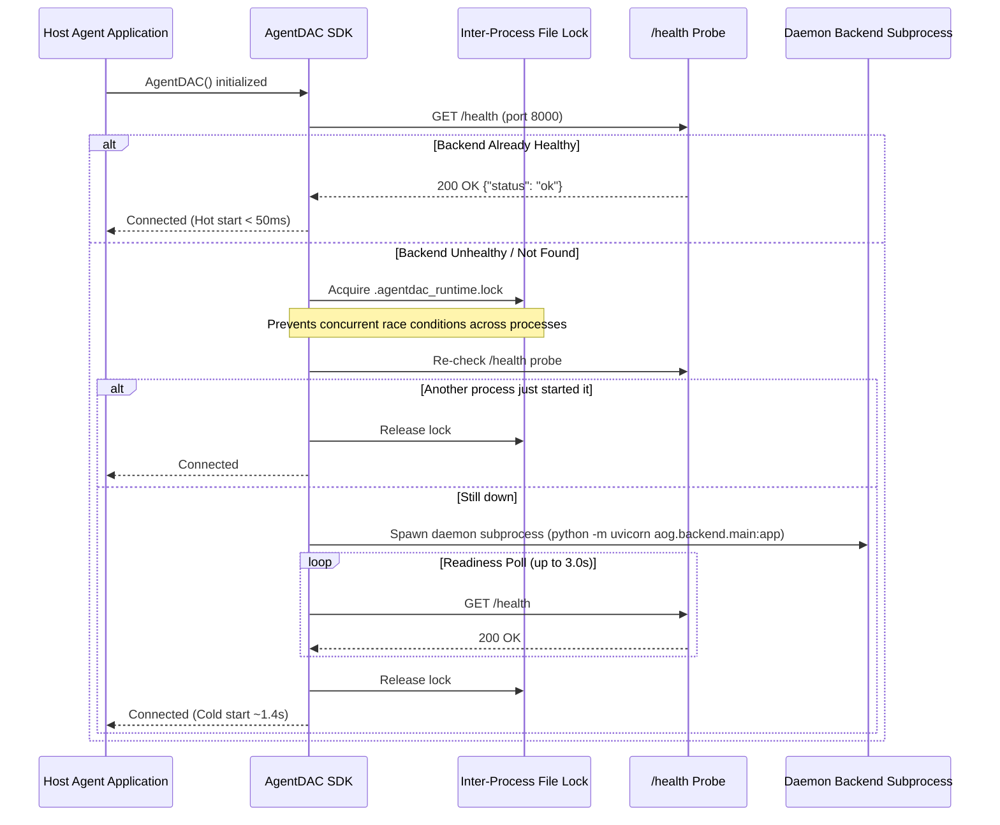

# AgentDAC — System Architecture & Technical Specification

> **Version**: 0.1.0  
> **Package**: `agentdac` / `aog`  
> **Status**: Production-Grade / Self-Contained  

---

## 1. High-Level Architectural Overview

AgentDAC is a self-contained, zero-configuration agent observability plugin and execution DAG visualizer. It is architected around an **event-first telemetry stream**, where every agent decision, tool execution, model inference, and skill procedure is captured as an OpenTelemetry-compatible immutable event.

```mermaid
flowchart TD
    subgraph HostApplication [User Agent Application]
        AgentCode["Agent Logic (LangGraph / CrewAI / Custom)"]
        SDK["AgentDAC SDK (aog / agentdac)"]
        Ctx["ContextVars Propagation Engine"]
        Sanitizer["Recursive Redaction Engine"]
        Exporter["Async Bounded Queue & Batch Exporter"]
    end

    subgraph AutoRuntime [AgentDAC Runtime Manager]
        Lock["Inter-Process File Lock (filelock)"]
        HealthProbe["HTTP /health Probe"]
        Subprocess["Daemon Backend Spawner"]
    end

    subgraph Backend [AgentDAC Local / Remote Backend (FastAPI)]
        Ingest["Idempotent Event Ingestion (/v1/events)"]
        TraceService["Trace & Span Service (/v1/traces)"]
        GraphEngine["Graph Builder & Cycle Detection (DFS)"]
        Analytics["Aggregate Telemetry Engine (/v1/analytics)"]
        ChatEngine["Zero-Hallucination Timeline Chat (/v1/chat)"]
    end

    subgraph Storage [Persistence Layer]
        SQLite[("Local SQLite (aiosqlite)")]
        PostgreSQL[("Production PostgreSQL (asyncpg)")]
    end

    subgraph Dashboard [Visualization & Inspection UI]
        ReactFlow["React 19 + React Flow Interactive DAG"]
        Waterfall["Timeline Waterfall View"]
        Inspector["Span & Payload Node Inspector"]
        AIChat["Interactive Debugging Assistant"]
    end

    AgentCode --> SDK
    SDK --> Ctx
    SDK --> Sanitizer
    Sanitizer --> Exporter
    Exporter --> Ingest

    SDK -.->|Auto-Detect / Spawn| AutoRuntime
    AutoRuntime -->|Health Verified| Backend

    Ingest --> Storage
    Storage --> TraceService
    Storage --> Analytics
    TraceService --> GraphEngine
    TraceService --> ChatEngine

    GraphEngine --> ReactFlow
    TraceService --> Waterfall
    TraceService --> Inspector
    ChatEngine --> AIChat
```

---

## 2. Core Design Principles

1. **Zero-Configuration Self-Management**: The user integrates the SDK; the SDK manages its own backend. No manual server startup, Docker commands, or port configurations required for local development.
2. **Fail-Open Resilience (`fail_open=True`)**: Observability must never crash the host application. If the backend is unavailable or the network partitions, events buffer and drop gracefully without raising unhandled exceptions in the agent loop.
3. **Event-First Immutability**: The event stream is the ground truth. Traces, spans, DAGs, and analytics are projections reconstructed from the ordered event stream.
4. **Deep Semantic Transitions**: Edges in the execution DAG are not mere lines; they are explicitly labeled with transition reasons (`invokes LLM`, `calls tool`, `uses skill`, `sub-agent`).
5. **Strict Privacy by Default**: Secrets, API keys, passwords, bearer tokens, and credentials are recursively scrubbed before payload transmission. Private chain-of-thought is never captured.
6. **Package Namespace Isolation**: All backend services and models reside strictly under `aog.backend` and `agentdac`. They never pollute or collide with host applications using generic module names like `server`, `models`, or `main`.

---

## 3. Subsystem Breakdown

### 3.1 Client SDK (`packages/aog-sdk/src/aog` & `src/agentdac`)

The client SDK provides an intuitive, ergonomic interface for instrumenting agent workflows:

- **Unified Facade (`AgentDAC` / `AOG`)**: The entry point for configuration, session creation, and manual span dispatch.
- **Context Managers**:
  - `aog.session(...)`: Establishes root trace context and session boundaries.
  - `aog.agent(...)`: Delimits specific agent role executions.
  - `aog.tool(...)`: Records tool inputs, execution timing, and return payloads.
  - `aog.llm(...)`: Captures model name, provider, token counts (in/out), and cost.
  - `aog.skill(...)`: Tracks specialized procedural capabilities (e.g., scoring algorithms, pacing balancers).
- **Decorators**: `@aog.observe`, `@aog.agent()`, `@aog.tool()`, `@aog.llm()`, `@aog.skill()`.
- **Context Propagation**: Employs Python standard library `contextvars.ContextVar` to maintain active `trace_id`, `span_id`, and `parent_span_id` across synchronous functions, async coroutines, and thread pools without explicit parameter passing.
- **Data Sanitizer (`aog.redaction.sanitizer`)**: Recursively traverses payloads to redact keys matching sensitive patterns (`api_key`, `token`, `password`, `secret`, `authorization`, `cookie`) and caps payload bytes to prevent memory bloat.

### 3.2 Runtime Lifecycle Manager (`aog.runtime`)

The Runtime Manager enables zero-config deployment by supervising the local backend process:



### 3.3 Non-Blocking Asynchronous Exporter (`aog.exporters`)

Telemetry collection operates completely out-of-band:
- **Bounded In-Memory Queue**: Spans are pushed to an asynchronous queue (`queue_size=5000`). If the queue fills up during network outages, new spans are dropped fail-open rather than stalling agent execution.
- **Background Worker**: Drains the queue in configurable batches (`batch_size=50`) or intervals (`flush_interval_ms=500`).
- **Jittered Exponential Backoff**: Transient HTTP errors trigger automatic retry with exponential backoff (up to `max_retries=3`).
- **Graceful Flush**: `aog.flush(timeout=3.0)` ensures all in-flight spans are delivered before process shutdown.

### 3.4 Backend Ingestion & Query Engine (`aog.backend`)

A high-performance FastAPI service handling ingestion and analytical queries:

- **API Routes**:
  - `POST /v1/events`: Bulk ingestion endpoint. Validates event schema, performs deduplication via idempotent `event_id`, and persists records.
  - `GET /v1/sessions`: Lists monitored sessions with status, duration, span count, and agent IDs.
  - `GET /v1/sessions/{id}`: Retrieves aggregate session metrics.
  - `GET /v1/sessions/{id}/trace`: Reconstructs the complete hierarchical span tree and execution DAG.
  - `GET /v1/analytics/overview`: Global statistics (total sessions, error rates, token volumes, tool usage distributions).
  - `POST /v1/chat`: Zero-hallucination conversational debugging assistant.
  - `GET /health`: Subsystem readiness probe.
- **Persistence Layer**:
  - **SQLite (`aiosqlite`)**: Zero-config default for local workstations. Fast, single-file (`aog.db`), zero installation.
  - **PostgreSQL (`asyncpg`)**: Production-grade storage for multi-user, distributed deployments with Alembic migrations.

### 3.5 Graph Builder & DAG Reconstruction Engine (`aog.backend.services.graph_builder`)

Transforms the flat list of spans into a Directed Acyclic Graph:
1. **Node Synthesis**: Maps each span to a graph node categorized by type (`session`, `agent`, `tool`, `llm`, `skill`).
2. **Edge Synthesis**: Links child spans to their parent spans using `parent_span_id`.
3. **Transition Semantics**: Computes human-readable transition labels based on source and target types:
   - `agent` $\rightarrow$ `llm`: `"invokes LLM"`
   - `agent` $\rightarrow$ `tool`: `"calls tool"`
   - `agent` $\rightarrow$ `skill`: `"uses skill"`
   - `agent` $\rightarrow$ `agent`: `"sub-agent"`
   - `session` $\rightarrow$ `agent`: `"initiates agent"`
4. **Cycle Detection**: Validates the tree using Depth-First Search (DFS) with node coloring to guarantee cycle-free execution.

### 3.6 Grounded AI Timeline Chat Assistant (`aog.backend.api.chat`)

Enables natural language debugging without hallucinations:
- **Prompt Injection Grounding**: The backend fetches all spans for the target session, formats a compact JSON timeline (ordered chronologically), and injects it as system context.
- **Constraint Directives**: The model is strictly instructed: *"Answer questions ONLY using facts directly stated in the timeline JSON. If information is not present, state clearly that it is unavailable."*
- **OpenAI-Compatible Engine**: Configurable via `AGENTDAC_CHAT_API_KEY`, `AGENTDAC_CHAT_MODEL`, and `AGENTDAC_CHAT_BASE_URL`.

### 3.7 React 19 Dashboard UI (`dashboard/`)

A modern, responsive, developer-focused interface built with:
- **React 19 & TypeScript**: Strict types for all events, spans, and DAG models.
- **React Flow**: High-performance interactive graph canvas with pan/zoom, custom node cards, and labeled SVG edges.
- **Timeline Waterfall**: Linear, Gantt-style waterfall visualization showing span latencies, concurrency, and bottlenecks.
- **Node Inspector Drawer**: Slide-over panel displaying exact input/output JSON payloads, token counts, costs, and error stack traces.
- **AI Chat Flyout**: Interactive chat interface for asking conversational questions about the active execution graph.

---

## 4. Universal Event Schema

All events adhere to the versioned `AgentEvent` specification:

```python
class AgentEvent(BaseModel):
    schema_version: str = "1.0"
    
    # Identification & Relationships
    event_id: str             # Unique UUID
    trace_id: str             # Session / Trace UUID
    span_id: str              # Logical operation UUID
    parent_span_id: str | None # Enclosing span UUID
    
    # Context
    session_id: str           # User or application session ID
    agent_id: str             # Host agent name/identifier
    
    # Classification
    event_type: EventType     # SESSION, AGENT, LLM, TOOL, SKILL, ERROR, etc.
    name: str                 # Operation name (e.g. "web_search", "validator_agent")
    
    # Temporal & Operational
    timestamp: datetime       # UTC ISO-8601 timestamp
    duration_ms: float | None # Elapsed execution time
    status: EventStatus       # OK, ERROR, CANCELLED
    
    # Payloads (Sanitized)
    input: dict | None = None
    output: dict | None = None
    attributes: dict = {}
    
    # Telemetry
    tokens_in: int | None = None
    tokens_out: int | None = None
    model: str | None = None
    provider: str | None = None
    cost_usd: float | None = None
    
    # Error Handling
    error: ErrorInfo | None = None
```

---

## 5. Security & Privacy Guarantees

1. **Automatic Secret Masking**: Keys matching `api_key`, `authorization`, `bearer`, `password`, `secret`, `cookie`, `token` have their string values replaced with `[REDACTED]`.
2. **No Private Chain-of-Thought**: AgentDAC captures inputs, outputs, decisions, and operational metadata. Hidden model reasoning buffers are never stored.
3. **Payload Truncation**: Inputs and outputs exceeding `max_payload_bytes` (default 100 KB) are safely truncated to avoid storage exhaustion and denial-of-service vulnerabilities.
4. **Idempotent Ingestion**: All events use cryptographic UUIDs; duplicate event deliveries are silently deduplicated at the storage layer without corrupting traces.

---

## 6. Deployment Modes

| Feature | Mode A: Managed Local Mode (Default) | Mode B: Remote / Distributed Mode |
| :--- | :--- | :--- |
| **Target Use Case** | Local development, interactive testing, CLI tools | Team environments, production agent deployments |
| **Backend Startup** | Automatic (managed subprocess) | Dedicated container / server (`docker compose up`) |
| **Database** | SQLite (`aog.db`) | PostgreSQL 16+ |
| **Locking Mechanism** | Inter-process file lock (`filelock`) | Distributed / stateless HTTP |
| **SDK Initialization** | `aog = AgentDAC()` | `aog = AgentDAC(endpoint="http://remote:8000", auto_start=False)` |
| **Dashboard** | `npm run dev` in `dashboard/` | Hosted React web build (`Dockerfile.dashboard`) |
