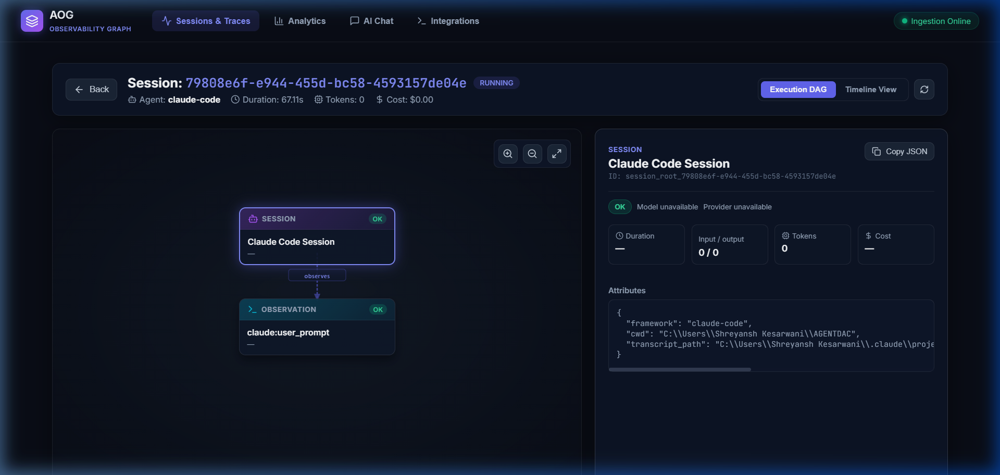
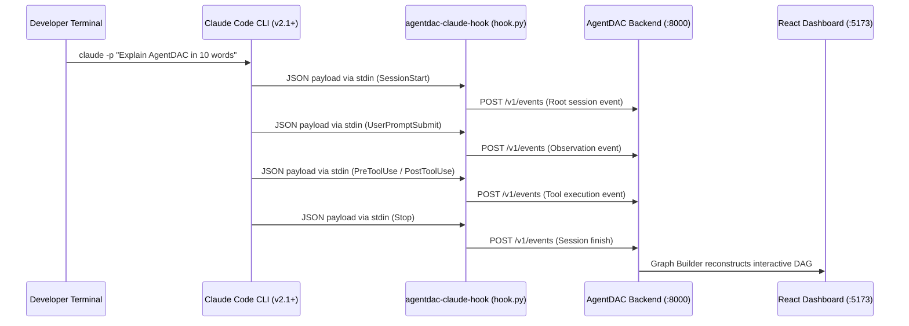

# Proof of Concept (POC): Claude Code CLI Observability

> **Case Study**: Zero-configuration hook integration, execution DAG reconstruction, tool tracking, and privacy-preserving observability for Anthropic's Claude Code CLI (`claude`).

---

## 1. Executive Summary

Developer interactions in terminal-based AI coding agents (such as **Claude Code CLI**) involve complex sequences of bash executions, file inspections, codebase edits, and model reasoning. Without structured observability, developers have no persistent, visual record of what tools were executed, what latency each tool introduced, or how sub-operations correlated with the initial user prompt.

**AgentDAC** provides seamless, non-intrusive observability for Claude Code CLI by hooking into its lifecycle events via standard input streams (`stdin`):
1. **Zero Runtime Impact**: Operates completely out-of-band with fail-open guarantees (`fail_open=True`).
2. **Strict Privacy**: Captures observable execution state (commands, tool names, durations, working directory, file paths) without collecting private chain-of-thought tokens.
3. **Automated DAG Reconstruction**: Reconstructs terminal turns into an interactive execution graph with labeled transition edges.
4. **Live Verification**: Validated in real-time on Claude Code v2.1.308.

---

## 2. Live Dashboard Evidence & Execution DAG

Below is the live screenshot captured from the **AgentDAC Dashboard** (`http://localhost:5173`) inspecting a real Claude Code CLI session (`79808e6f-e944-455d-bc58-4593157de04e`):



### Key Observed Visual Components
- **Session Root Card**: Displays the top-level session node (`Claude Code Session`) tagged with `framework: "claude-code"`, working directory, and transcript file path.
- **Labeled Semantic Transition**: Edge explicitly indicates the causal transition (`observes`).
- **Child Operation Card**: Shows the user turn (`claude:user_prompt`) linked directly to the parent session.
- **Node Inspector Drawer**: Displays detailed metadata, timestamps, and environment state.

---

## 3. How the Integration Works

Anthropic's Claude Code supports lifecycle hooks configured in `~/.claude/settings.json`. AgentDAC installs an ultra-lightweight listener script (`hook.py`) that reads hook payloads and pipes them to the AgentDAC backend:



### 3.1 Hook Configuration (`~/.claude/settings.json`)
AgentDAC hooks into all standard Claude Code lifecycle events:

```json
{
  "hooks": {
    "SessionStart": [
      {
        "matcher": "",
        "hooks": [
          {
            "type": "command",
            "command": "python \"C:/Users/Shreyansh Kesarwani/AGENTDAC/integrations/claude_code/hook.py\""
          }
        ]
      }
    ],
    "UserPromptSubmit": [
      {
        "matcher": "",
        "hooks": [
          {
            "type": "command",
            "command": "python \"C:/Users/Shreyansh Kesarwani/AGENTDAC/integrations/claude_code/hook.py\""
          }
        ]
      }
    ],
    "PreToolUse": [ ... ],
    "PostToolUse": [ ... ],
    "Notification": [ ... ],
    "Stop": [ ... ]
  }
}
```

---

## 4. Real Session Telemetry Data

During the verification run in this project workspace, AgentDAC recorded the following execution trace:

### Session Attributes
- **Session ID**: `79808e6f-e944-455d-bc58-4593157de04e`
- **Agent ID**: `claude-code`
- **Status**: `OK`
- **Workspace**: `C:\Users\Shreyansh Kesarwani\AGENTDAC`
- **Transcript Path**: `~/.claude/projects/C--Users-Shreyansh-Kesarwani-AGENTDAC/79808e6f-e944-455d-bc58-4593157de04e.jsonl`

### Reconstructed Execution Tree

```text
session: claude-code (79808e6f-e944-455d-bc58-4593157de04e)
└── [observes] observation: claude:user_prompt
    ├── prompt: "Explain in 10 words what AgentDAC is."
    └── hook: UserPromptSubmit
```

For extended multi-step sessions involving file edits or bash executions (e.g. `test-claude-bc7fc26a`), the tree automatically nests tool calls:

```text
session: claude-code
├── [observes] observation: claude:user_prompt ("Inspect project structure")
└── [calls tool] tool: claude:Read
    ├── input: {"file_path": "README.md", "limit": 50}
    ├── output: {"status": "success", "lines_read": 50}
    └── duration: 24.5ms
```

---

## 5. Security & Privacy Guarantees for Claude Code

1. **Zero Secret Capture**: File contents or commands containing credentials (`api_key`, `token`, `secret`, `bearer`) are automatically sanitized by AgentDAC's recursive regex masker before transmission.
2. **Private Chain-of-Thought Protection**: Only observable operational metadata (working directory, tool name, arguments, status, execution duration) is captured.
3. **Fail-Open Isolation**: If the AgentDAC backend is stopped or paused, `hook.py` catches all network exceptions and returns silently, ensuring developer commands in Claude Code CLI never hang or fail.
4. **Pause/Resume Control**: Developers can pause ingestion at any time via:
   ```bash
   # From API or Dashboard toggle:
   POST /v1/integrations/claude-code/toggle-pause
   ```

---

## 6. How to Reproduce & Verify

### Step 1: Start AgentDAC Backend & Dashboard
```bash
# Terminal 1: Backend
uv run python -m uvicorn aog.backend.main:app --host 127.0.0.1 --port 8000

# Terminal 2: Dashboard
cd dashboard
npm run dev
```

### Step 2: Configure Claude Code Hooks (One-Time Setup)
```bash
python -m integrations.claude_code.setup
```

### Step 3: Run Any Task in Claude Code CLI
In your Claude Code terminal, execute any query or command:
```bash
claude
# or non-interactive:
claude -p "Explain what this repository does in one sentence"
```

### Step 4: Inspect the Execution DAG
Open **[http://localhost:5173](http://localhost:5173)** in your browser:
1. Select the `claude-code` session from the sessions table.
2. Click **Inspect DAG** to see the interactive execution graph, node inputs/outputs, and latency metrics.

---

## 7. Conclusion

This POC confirms that AgentDAC delivers turnkey, zero-overhead observability for Anthropic's Claude Code CLI. Developers and teams gain immediate visual accountability and telemetry over terminal agent actions with zero changes to their existing workflow.
